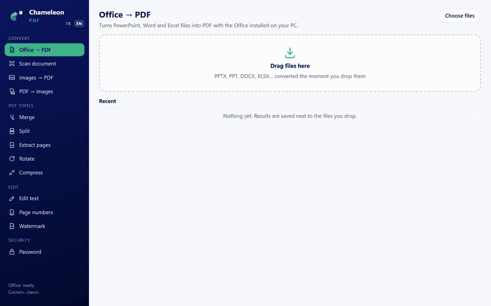
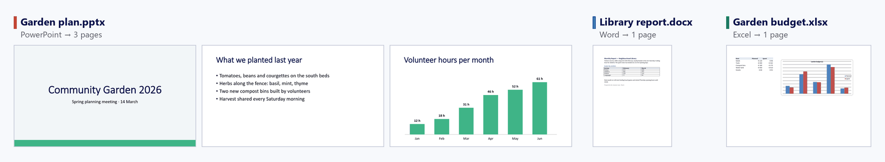
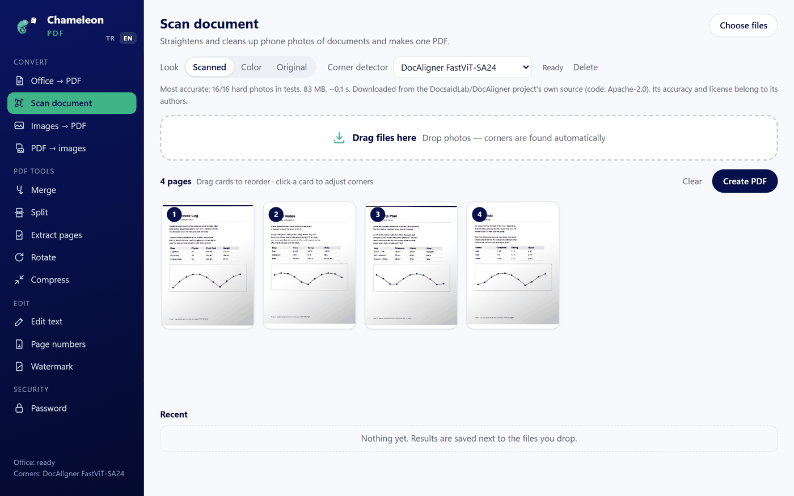
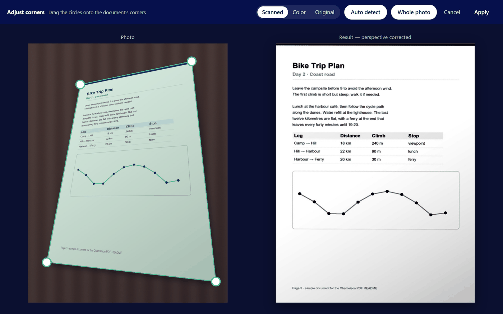
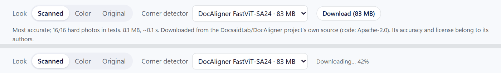
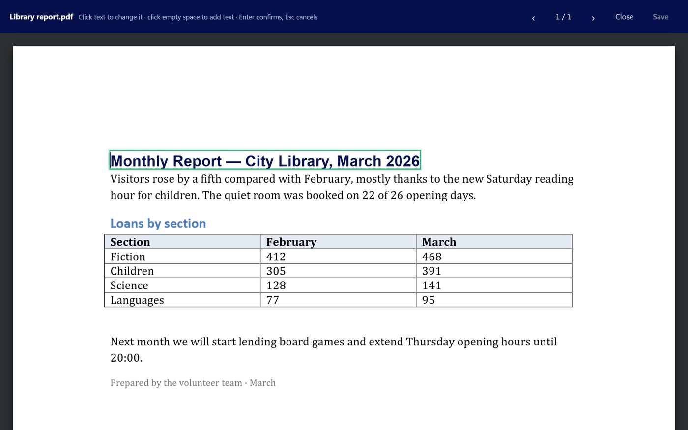

# Chameleon PDF Desktop

**Drag a PowerPoint, Word or Excel file onto the window. Get a PDF.** Free, offline, no account, no upload.

<p align="center"></p>

<p align="center"><b><a href="../../releases/latest">⬇ Download for Windows</a></b> · 13 MB · Windows 10/11 x64</p>

Chameleon PDF is a small Windows app ([Tauri 2](https://tauri.app), Rust + WebView2) with a PDF toolbox built around one idea: you drop files, results appear next to them. It is the desktop companion of the Android app *Chameleon PDF*. The interface is in **English and Turkish** (it follows your Windows language; switch with **TR / EN** at the top left).

---

## Office → PDF in one drag

- **Drop one file or a whole folder's worth.** Conversion starts the moment you let go. There is no button to press and no dialog to answer.
- **Identical to Office's own export.** The app drives the Microsoft Office already installed on your PC (PowerPoint, Word, Excel), so fonts, charts, tables and layouts come out as Office's own *Save as PDF* makes them.
- **Next to the original.** `Garden plan.pptx` becomes `Garden plan.pdf` in the same folder. Nothing is ever overwritten; a second copy becomes `Garden plan (2).pdf`.
- **Your open Office windows are left alone.** Office runs hidden; if PowerPoint, Word or Excel was already open, it stays open.
- **Fast.** These three sample files were converted in 5.8 s in total on the author's PC, including starting Office: PowerPoint 1.5 s, Word 1.7 s, Excel 2.2 s.

Supported: `pptx` `ppt` `pptm` `ppsx` `pps` `potx` `odp` · `docx` `doc` `docm` `odt` `rtf` · `xlsx` `xls` `xlsm` `xlsb` `ods` `csv`

<p align="center"></p>

<sub>What came out of the three files in the animation above, rendered straight from the PDFs.</sub>

> Office → PDF needs Microsoft Office. Every other tool works without it.

---

## Scan documents with your phone

Drop photos of paper; each becomes a straight, clean page. Drag the cards to put pages in order, then press **Create PDF**.

<p align="center"></p>

Click a page to see what happened: the corners found in the photo on the left, the perspective-corrected result on the right. Drag a corner to fix it — a magnifier follows your cursor — and the result updates when you let go.

<p align="center"></p>

Three looks: **Scanned** (shadows removed, clean grey on white), **Color** (shadows removed) and **Original** (perspective only).

### You choose the corner detector

Classic edge detection is built in. For much better results on cluttered desks, shadows and slides photographed from your seat, pick a [DocAligner](https://github.com/DocsaidLab/DocAligner) model and press **Download**. Nothing is downloaded until you do.

<p align="center"></p>

- The model comes from the DocAligner project's own source, not from this repository, and is checked against a fixed SHA-256 before it is used. Its accuracy and license belong to its authors (DocAligner's code is Apache-2.0; the weights have no separately stated license).
- Models are kept in `%LOCALAPPDATA%\com.bukalemun.masaustu\modeller` and can be deleted from the same menu.
- Pages you have not adjusted by hand are re-detected when you switch detectors.

| Detector | Size | Hard photos (16) | Easy photos (10) |
|---|---|---|---|
| Classic (built in) | – | 5 | 9 |
| DocAligner FastViT-SA24 | 83 MB | **16** | **9** |
| DocAligner LCNet100 | 5 MB | **16** | 6 |
| DocAligner FastViT-T8 | 13 MB | 15 | 3 |

<sub>Corners counted as correct when within 1.5 % of the image diagonal. "Hard" photos are synthetic: cluttered desk, hard shadows, a hand over the page, low-contrast background, strong perspective. These numbers are not a promise about your photos — try the detectors and keep the one that works for you. FastViT-SA24 takes about 0.1 s per photo on a CPU.</sub>

---

## Edit text in a PDF

Click any line and type over it, or click empty space to add a new line. Size, weight and colours are measured from the page; non-Latin characters (ç, ğ, İ, ş, …) work.

<p align="center"></p>

> **How it works, honestly:** the old text is covered with a box in the background colour and the new text is drawn on top. The page looks and prints changed, but copying or searching the PDF can still find the old words. True in-place editing is not possible in general, because PDFs usually embed only the letters they use.

---

## Everything else

| Tool | What it does |
|---|---|
| **Merge** | Joins PDFs in the order you set by dragging. |
| **Split** | Every *N* pages into a new folder. |
| **Extract pages** | `1-3, 5, 8-`, in any order, into a new PDF. |
| **Rotate** | 90° left/right or 180°, all pages or a range. |
| **Compress** | Downsizes and recompresses embedded images (Light / Medium / Strong). Text and vector graphics are untouched. |
| **Images → PDF** | Photos in order; JPEGs are embedded without recompression. |
| **PDF → images** | PNG or JPG at screen, normal or print quality. |
| **Page numbers** | `1`, `1 / 10` or `Page 1`, bottom center / bottom right / top right. Rotated pages are handled. |
| **Watermark** | Diagonal, semi-transparent text on every page. |
| **Password** | Add an AES-256 password, or remove one you know. |

All tools run on your machine. Results are saved next to the source file with a suffix such as `- merged`, `- scan` or `- compressed`.

---

## Install

1. Download `ChameleonPDF-windows-x64.zip` from [Releases](../../releases/latest).
2. Unzip anywhere and run `ChameleonPDF.exe`. There is no installer.

Requires Windows 10 or 11 (x64) with the WebView2 runtime (built into Windows 11). The exe is not code-signed, so SmartScreen may warn on first launch: *More info → Run anyway*.

## Build from source

```powershell
# Rust (stable) from https://rustup.rs
cd src-tauri
cargo build --release
# -> target\release\chameleon-pdf.exe
```

The `ort` crate downloads a prebuilt ONNX Runtime during the first build and links it statically. The UI in `ui/` is plain HTML/CSS/JS with no build step. `scripts/download-model.ps1` fetches a corner model for development builds.

| Path | What it does |
|---|---|
| `src-tauri/src/main.rs` | Tauri commands, output naming, Office conversion driver |
| `src-tauri/src/office.ps1` | Office COM automation (hidden; never closes Office windows you had open) |
| `src-tauri/src/pdf.rs` | Merge, split, extract, rotate, images → PDF (lopdf) |
| `src-tauri/src/duzen.rs` | Overlays (page numbers, watermark, text edits), compression, encryption |
| `src-tauri/src/yazi.rs` | Subset-embeds a Windows font as Type0 / Identity-H |
| `src-tauri/src/tarama.rs` | Classic corner detection, perspective warp, shadow removal |
| `src-tauri/src/model.rs` | Model catalogue, download + SHA-256 check, DocAligner inference (ONNX Runtime) |
| `src-tauri/src/gorsel.rs` | PDF → image via `Windows.Data.Pdf` |
| `src-tauri/src/dil.rs`, `ui/dil.js` | English / Turkish strings |
| `ui/` | The interface (pdf.js vendored in `ui/pdfjs/`) |

Code identifiers are Turkish (`birlestir` = merge, `bol` = split, `tarama` = scan, `yazi` = font …).

### Tests

```powershell
cd src-tauri
$env:CHAMELEON_TEST = "C:\folder\with\two\pdfs\and\some\jpgs"
$env:CHAMELEON_TARAMA = "C:\photos\with\gercek.json"   # optional: corner accuracy
cargo test -- --nocapture --test-threads=1
```

The tests run the real operations on your files and check results by rendering them with the Windows PDF engine. `gercek.json` maps each photo to its four true corners (`[[x,y],…]`, 0–1, clockwise from top-left).

The screenshots in this README show sample files written for it; the scan results and corner positions in them are the app's own output.

## License

[MIT](LICENSE). Third-party components and their licenses: [THIRD_PARTY_NOTICES.md](THIRD_PARTY_NOTICES.md).
